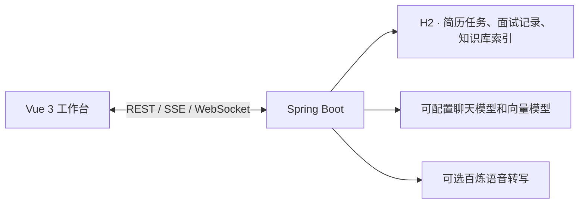

# AI Interview Workbench

**Java 21 · Spring Boot 3.5 · Vue 3 · TypeScript · H2**

[旧版在线演示（需账号）](https://8.163.102.189/) · [本地启动](#快速开始) · [系统架构](#系统架构)

## 项目介绍

AI Interview Workbench 是一款面向求职者的 AI 面试辅助平台，整合简历分析、文字与语音模拟面试、面试日程、知识库问答、题库练习和多模型配置，覆盖投递准备、面试练习与复盘。

平台支持通过 OpenAI 兼容接口接入**大语言模型（LLM）**，用于简历分析、面试反馈和 **SSE 流式问答**。配置向量模型后，系统将文档分块向量存入 **H2**，结合关键词匹配与余弦相似度检索资料，生成带原文引用的 RAG 回答。

简历上传后进入 **H2 任务表**，由 Spring 定时调度执行异步分析，并支持临时故障重试。语音面试支持**实时转写**和浏览器朗读。配置阿里云百炼 Fun-ASR 后，音频可通过 **WebSocket** 转发给云端模型实时转写。

| 知识库管理 | 问答助手 |
| --- | --- |
|  |  |

## 可以做什么

| 模块 | 操作流程 |
| --- | --- |
| 知识库与问答 | 批量导入 PDF、DOCX、TXT、Markdown 或粘贴文本。支持按资料范围流式问答、查看原文引用。从知识库面试总览查看每份资料的有效题目和练习次数，进入题库管理、出题或开始练习。 |
| 简历管理 | 导入 PDF、DOCX、TXT、Markdown 或粘贴文本，填写目标岗位后提交异步分析。从简历库查看进度、重试失败任务、下载原件或导出 PDF 报告。 |
| 模拟面试 | 在同一个面试中心选择文字或语音模式，按主题与难度配置 3–20 道题，可关联已分析的简历、选择本场模型或根据岗位描述练习。最近记录支持续练、查看报告和按原主题、难度与题量重新练习。总记录页汇总文字、语音和知识库练习。文字模式支持暂存、收藏、跳题和提前交卷。语音模式支持字幕、暂停恢复和文字输入。完成后可查看逐题反馈并导出 PDF。 |
| 日程与设置 | 粘贴面试邀请并确认提取结果，在日、周、月或列表中管理日程。支持拖拽改期、修改状态和日程页内提醒。可保存并切换多套模型配置。 |

## 系统架构



## 快速开始

环境需要 **Java 21、Maven 3.9+、Node.js 20+、pnpm**。构建和运行后端的命令都从 `backend/` 执行，本地数据库和模型密钥文件会写入 `backend/data/`。

### 单 JAR 运行

先在仓库根目录构建 Vue，再让 Maven 把前端产物打进可执行 JAR。

```bash
git clone https://github.com/lxh204/Ai-interview-workbench.git
cd Ai-interview-workbench
pnpm --dir frontend install --frozen-lockfile
pnpm --dir frontend build
cd backend
mvn clean package
java -jar target/interview-workbench-1.0.0.jar
```

打开 [http://127.0.0.1:8092](http://127.0.0.1:8092)。默认使用演示模式，简历分析返回规则反馈，问答返回本地检索结果，可以直接练习内置面试题。旧版链接的路径也可打开对应入口，例如 [模拟面试](http://127.0.0.1:8092/interview-hub) 和 [面试日程](http://127.0.0.1:8092/interview-schedule)。

### 用内置资料试一次问答

1. 在「知识库管理」选择「导入资料 → 粘贴文本 → 填入示例」，导入「Spring 事务复习笔记」。
2. 在资料行点「问答」，确认本次问答范围包含刚导入的文档。
3. 提问「Spring 事务为什么在同一个对象内部调用时可能失效？」，展开引用，查看系统命中的原文片段。

### 前后端分开开发

在两个终端中分别从仓库根目录执行。

```bash
# 终端一
cd backend
mvn spring-boot:run
```

```bash
# 终端二
cd frontend
pnpm install --frozen-lockfile
pnpm dev
```

打开 [http://127.0.0.1:5182](http://127.0.0.1:5182)。Vite 把 `/api` 转发到后端，默认目标为 `http://127.0.0.1:8092`，可用 `API_PROXY_TARGET` 覆盖。

## 实现要点

- **简历去重和任务恢复**。按文件 SHA-256 与目标岗位做联合唯一约束。上传后写入待分析任务，页面轮询状态。后端重启时，重新调度中断的处理任务。模型限流、连接异常和可恢复的服务端错误最多自动重试三次。[简历任务代码](backend/src/main/java/com/interviewlab/workbench/resume/ResumeReviews.java)
- **历史题目筛选**。优先安排同方向、主题和练习方式下还未答过的主问题。候选题不足时，从最久未练的题中补齐。 [选题代码](backend/src/main/java/com/interviewlab/workbench/interview/InterviewQuestions.java)
- **答题进度与并发提交**。在一个数据库事务里校验当前题号、推进进度和保存答题记录。重复或过期的提交返回 `409`，页面可以重新读取最新进度。[面试服务代码](backend/src/main/java/com/interviewlab/workbench/interview/InterviewService.java)
- **检索范围与出处**。先按会话选定的文档过滤，再将问题交给关键词检索与可选的向量排序。连接聊天模型后，通过 SSE 推送回复增量，校验最终回复的引用编号，并单独展示实际命中的片段。[检索与回答代码](backend/src/main/java/com/interviewlab/workbench/knowledge/KnowledgeAnswers.java) · [SSE 接口](backend/src/main/java/com/interviewlab/workbench/knowledge/KnowledgeChatController.java)

## 模型与运行配置

在「设置」中保存 OpenAI 兼容模型服务，测试连接后启用，也可以在启动后端前设置环境变量。

| 环境变量 | 含义 |
| --- | --- |
| `AI_BASE_URL` | 服务的 OpenAI 兼容基址，填写到 `/v1` 等服务版本路径 |
| `AI_API_KEY` | 服务密钥 |
| `AI_CHAT_MODEL` | 聊天模型名称 |
| `AI_EMBEDDING_MODEL` | 可选。启用后，新导入或重建索引的文档会生成向量，可与关键词检索混合使用 |
| `WORKBENCH_ASR_API_KEY` / `WORKBENCH_ASR_WORKSPACE` | 可选。配置北京地域阿里云百炼业务空间和 API Key 后，可选用 Fun-ASR 实时转写 |
| `WORKBENCH_HOST` / `WORKBENCH_PORT` | 后端监听地址和端口，默认 `127.0.0.1:8092` |
| `WORKBENCH_DB_URL` | H2 JDBC 地址，默认使用后端工作目录下的 `data/workbench` |
| `WORKBENCH_PDF_FONT` | PDF 导出使用的中文 TrueType 字体路径。Windows 默认尝试系统黑体 |

在页面保存的 API Key 经加密后写入数据库。备份数据时一并保留 `backend/data/model-store.key`，并将整个 `data/` 目录留在本机。启用云端模型后，相关简历文本、面试回答和检索片段会发给所配置的服务。配置向量模型后，导入或重建索引时会将文档片段发给该服务。语音识别默认使用浏览器，云端模式会将录音发送到配置的百炼服务。题目朗读使用浏览器语音合成，录音需要麦克风授权。当前配置面向本机使用，公网部署需要添加认证和访问控制。

## 目录与验证

| 路径 | 内容 |
| --- | --- |
| [`frontend/src/views/`](frontend/src/views) | Vue 页面与交互 |
| [`backend/src/main/java/com/interviewlab/workbench/`](backend/src/main/java/com/interviewlab/workbench) | 简历任务、面试、日程、知识库与模型接入 |
| [`backend/src/test/`](backend/src/test) | 后端接口和模型协议测试 |

在仓库根目录运行。

```bash
mvn -f backend/pom.xml verify
pnpm --dir frontend build
```

后端测试包括异步简历去重、答题冲突、知识库练习、日程和模型配置。模型协议用本地模拟服务测试，前端构建包含 TypeScript 类型检查。

## 项目参考

简历库、面试中心和知识库面试的操作流程参考 [InterviewGuide](https://github.com/Snailclimb/interview-guide)。本仓库使用 Vue 3、Spring Boot 和 H2 实现这些流程。
