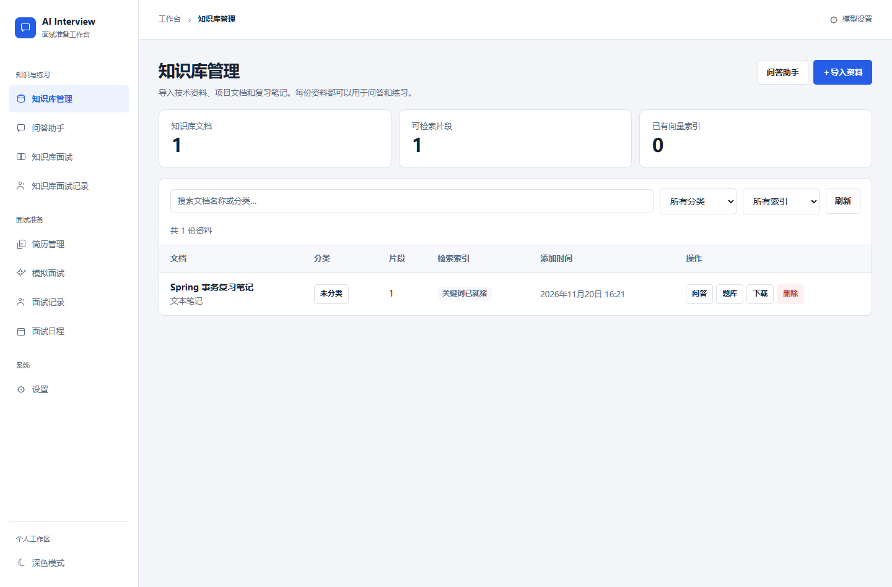
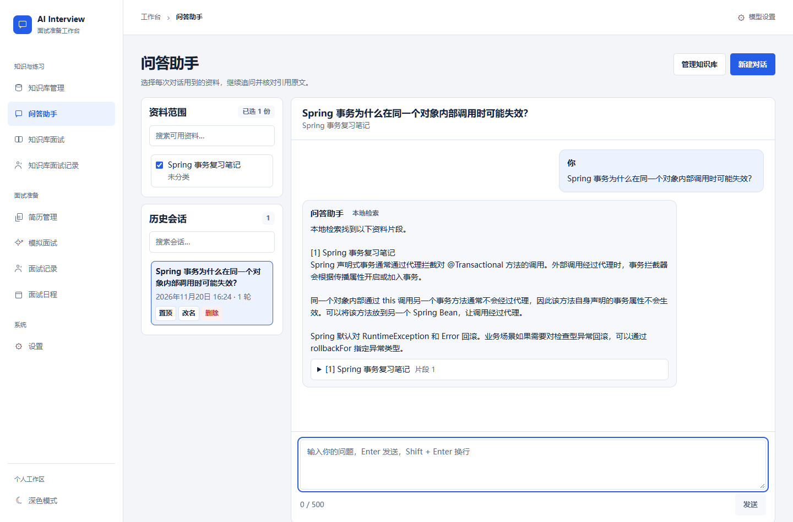

# 候场 · 面试工作台（Interview Workbench）

面向 Java / AI 应用求职者的面试准备工作台：把复习笔记变成**可检索、可溯源**的知识库，把简历变成**可分析、可导出**的报告，把面试变成**可演练、可复盘**的流程。全栈自研，单 JAR 交付，离线即可跑通全部流程。

`Java 21` `Spring Boot 3.5` `Vue 3` `TypeScript` `H2` `SSE` `单 JAR 交付`

**在线演示**：<https://8.163.102.189/>（访问账号可提供）

## 功能特性

### 知识与练习

- **知识库管理**：导入 PDF / TXT / Markdown，自动分块并展示索引状态；支持分类、索引状态筛选与原文下载。
- **问答助手**：按会话圈定资料范围，多轮追问；回答附编号引用，可展开核对原文片段；连接模型后以 SSE 流式输出。
- **知识库面试**：从指定资料生成题库，逐题练习并回看练习记录。

### 面试准备

- **简历管理**：上传或粘贴简历，SHA-256 去重避免重复分析；异步分析 + 状态轮询，列表 / 详情 / PDF 报告导出完整闭环。
- **模拟面试**：可配置面试方向与题量；刷新后恢复答题进度；同一题并发提交只保存一次。
- **语音面试**：浏览器语音识别 + 语音合成，实时字幕、暂停 / 恢复；不支持语音的环境可回退文本输入。
- **记录与日程**：面试记录回看、报告导出、面试日程编辑。

### 系统

- **多模型服务**：新增、切换、连通性验证与移除；API Key 加密后写入本地数据库。
- **离线演示模式**：不接模型也能用——规则化简历反馈、可复现的关键词检索，界面内置「填入示例」一键体验。

## 界面截图

| 知识库管理 | 问答助手（带原文引用） |
| --- | --- |
|  |  |

## 技术栈

| 层 | 选型 |
| --- | --- |
| 后端 | Java 21、Spring Boot 3.5.16（Web / Validation / JDBC）、H2 文件数据库、PDFBox 3.0.6 |
| 前端 | Vue 3.5、TypeScript 5.7、Vite 5、vue-tsc 类型检查 |
| 交付 | Maven 将前端产物打包进可执行 JAR，一个文件启动整站 |
| 验证 | JUnit 5 后端测试 + 浏览器多路由桌面 / 移动端验收 |

## 快速开始

环境要求：Java 21、Maven 3.9+、Node.js 20+、pnpm。

### 方式一：单 JAR（推荐）

```powershell
pnpm --dir frontend install --frozen-lockfile
pnpm --dir frontend build
mvn -f backend/pom.xml clean package
java -jar backend/target/interview-workbench-1.0.0.jar
```

浏览器打开 <http://127.0.0.1:8092>。

### 方式二：开发模式

```powershell
# 终端 1：后端
mvn -f backend/pom.xml spring-boot:run

# 终端 2：前端
pnpm --dir frontend install --frozen-lockfile
pnpm --dir frontend dev
```

浏览器打开 <http://127.0.0.1:5182>，开发服务器将 API 请求代理到 `127.0.0.1:8092`（可用 `VITE_API_PROXY_TARGET` 改指向）。

首次启动会在 `backend/data/` 创建本地 H2 数据库；知识库与简历页面均提供「填入示例」，无需准备材料即可体验。

## 启用大模型

默认运行离线演示模式。可在「设置」页新增并启用模型服务，或在启动后端时设置环境变量：

| 环境变量 | 说明 |
| --- | --- |
| `AI_BASE_URL` | OpenAI 兼容基址（通常以 `/v1` 结束） |
| `AI_API_KEY` | 服务访问密钥 |
| `AI_CHAT_MODEL` | 聊天模型名称 |
| `AI_EMBEDDING_MODEL` | 可选；配置后新导入或重建索引的资料保存向量，问答混合关键词与向量检索 |

通过页面添加的密钥加密后写入本地数据库，解密密钥保存在 `data/model-store.key`。百炼等服务的基址与模型名称以账户控制台接入信息为准；更换向量模型后旧文档保留关键词检索能力，重新导入即可生成新向量。

## 其他配置

| 配置 | 说明 |
| --- | --- |
| `WORKBENCH_PDF_FONT` | 报告导出所用中文 TrueType 字体路径；Windows 默认尝试黑体 |
| `server.port` / `server.address` | 后端监听地址，默认 `127.0.0.1:8092` |
| `VITE_API_PROXY_TARGET` | 前端开发服务器 API 代理目标 |

## 项目结构

```
backend/src/main/java/com/interviewlab/workbench/
├── knowledge/   # 文档导入与分块、检索、会话问答、题库与练习
├── resume/      # 简历文件解析、去重、异步分析与报告
├── interview/   # 出题、答题服务、并发幂等、记录与报告
├── schedule/    # 面试日程
├── ai/          # 模型网关与多模型设置（SSE、密钥加密）
├── report/      # PDF 报告渲染
└── StatusController / ApiErrors  # 运行状态与统一错误语义
frontend/src/
├── views/       # 知识库、问答、简历、面试、语音、日程、设置等页面
├── api.ts       # 后端接口封装
└── examples.ts  # 内置示例材料
```

## 验证

```powershell
mvn -f backend/pom.xml verify   # 12 项后端测试
pnpm --dir frontend build       # vue-tsc 类型检查 + Vite 构建
```

浏览器验收覆盖 11 条路由（知识库管理 / 问答助手 / 知识库面试 / 练习记录 / 简历管理 / 上传简历 / 模拟面试 / 面试记录 / 语音面试 / 面试日程 / 系统设置），桌面 1440px 与移动 390px 双视口通过，无横向溢出、无页面报错。

## 安全与边界

- 演示模式不向外发送数据；启用模型后，提交的简历、回答与问题相关资料会发送到所配置的模型服务。
- 密钥加密落盘；`data/` 目录与密钥文件不应提交到版本库。
- 当前版本面向本机练习；公网部署需自行补充认证与访问控制。
- 语音面试依赖浏览器语音识别 / 朗读能力与麦克风授权。
